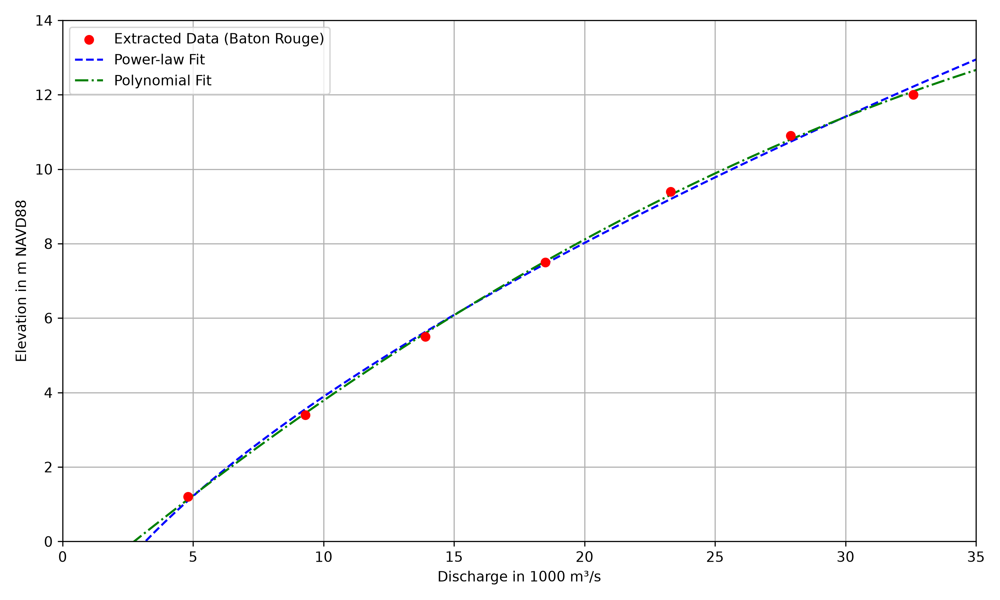
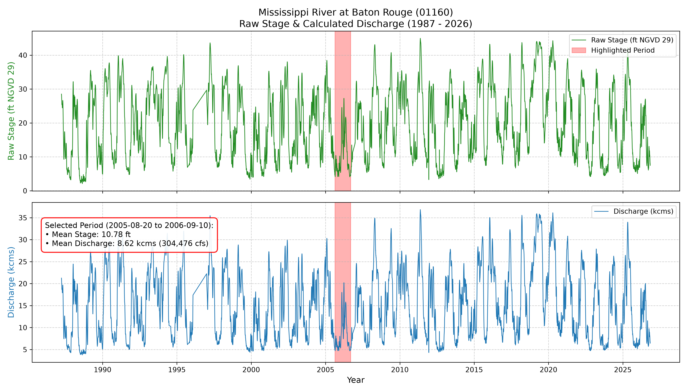

<h2 align="center">
		Coastal Emergency Risks Assessment (CERA) <br/>
		  <br/><a target="_blank" href="https://cera.coastalrisk.live/">cera.coastalrisk.live</a>
</h2>
<br/>

[← Back to the tutorial index](../README.md)

# Stage-Discharge Curve Fitting for River Flow

## About this tutorial

Extracts the flow-stage relationship for the Baton Rouge station from Figure 3 of the published rating curve and fits a stage-discharge curve. The tutorial then fetches historical RiverGages stage data and converts it to discharge and flow.

## Getting Started

Requires Python 3.15.2 and the shared packages in `requirements.txt`:

```bash
python3 -m pip install -r requirements.txt
```

### Jupyter Notebook

[](https://colab.research.google.com/github/CERA-GROUP/Tutorials/blob/main/Calculating%20River%20Flow/cera_river_flow.ipynb)

### Input data

* The Baton Rouge discharge-stage points were digitized from Fig. 3 of Martyr et al. (2013).
* The hydrograph section fetches historical data from the online USACE RiverGages portal.

Run the tutorial from this folder:

```bash
cd "Calculating River Flow"
jupyter lab cera_river_flow.ipynb
```

## Example output





## References

Martyr, R. C., Dietrich, J. C., Westerink, J. J., Kerr, P. C., Dawson, C., Smith, J. M., Pourtaheri, H., Powell, N., Van Ledden, M., Tanaka, S., Roberts, H. J., Westerink, H. J., & Westerink, L. G. (2013). Simulating Hurricane Storm Surge in the Lower Mississippi River under Varying Flow Conditions. *Journal of Hydraulic Engineering, 139*(5), 492–501. https://doi.org/10.1061/(ASCE)HY.1943-7900.0000699
