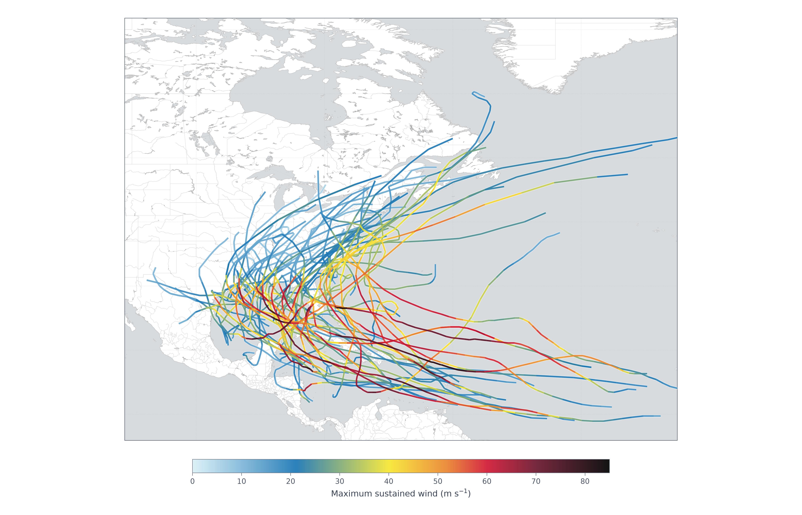

<h2 align="center">
		Coastal Emergency Risks Assessment (CERA) <br/>
		  <br/><a target="_blank" href="https://cera.coastalrisk.live/">cera.coastalrisk.live</a>
</h2>
<br/>

[← Back to the tutorial index](../README.md)

# Visualizing Multiple NHC Tracks with Matplotlib

## About this tutorial

Load the master ATCF best-track catalog, color each track segment by maximum sustained wind, and export one overview map.

## Getting Started

Requires Python 3.15.2 and the shared packages in `requirements.txt`:

```bash
python3 -m pip install -r requirements.txt
```

### Jupyter Notebook

[](https://colab.research.google.com/github/CERA-GROUP/Tutorials/blob/main/Visualizing%20Multiple%20NHC%20Tracks%20with%20Matplotlib/cera_multiple_tracks.ipynb)

### Python standalone

* Direct python script [file](cera_multiple_tracks.py).
* Check the tutorial [instructions](cera_multiple_tracks.ipynb).

### Input data

* `tracks/storm_dat_files.csv` lists the cataloged storms and their `.dat` filenames.
* The track files live under `tracks/{year}_{storm}/bal*.dat`.

Run the tutorial from this folder:

```bash
cd "Visualizing Multiple NHC Tracks with Matplotlib"
python3 cera_multiple_tracks.py
python3 cera_multiple_tracks.py --output example_1_plot.png
python3 cera_multiple_tracks.py --output example_1_plot.png --no-show
jupyter lab cera_multiple_tracks.ipynb
```

### Command line options

    cera_multiple_tracks.py [--data-root DATA_ROOT] [-o OUTPUT] [--dpi DPI] [--branded] [--no-show]

optional:

      --data-root       directory containing storm_dat_files.csv (default: tracks)
      -o | output       output image path (default: example_1_plot.png)
      --dpi             resolution for the saved image (default: 300)
      --branded         add the CERA title, logo, and footer
      --no-show         do not open the interactive plot window

## Example output


