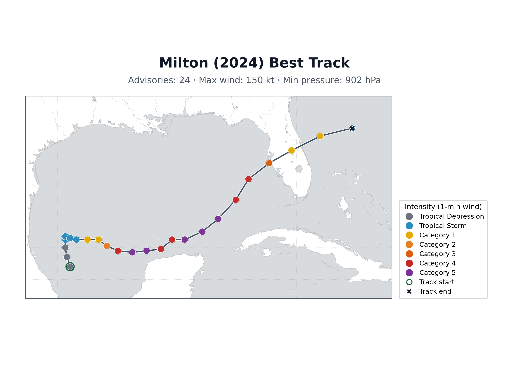

<h2 align="center">
		Coastal Emergency Risks Assessment (CERA) <br/>
		  <br/><a target="_blank" href="https://cera.coastalrisk.live/">cera.coastalrisk.live</a>
</h2>
<br/>

[← Back to the tutorial index](../README.md)

# Visualizing a Single NHC Track with Matplotlib

## About this tutorial

Render one ATCF best-track file into a publication-style map.

## Getting Started

Requires Python 3.15.2 and the shared packages in `requirements.txt`:

```bash
python3 -m pip install -r requirements.txt
```

### Jupyter Notebook

[](https://colab.research.google.com/github/CERA-GROUP/Tutorials/blob/main/Visualizing%20a%20Single%20NHC%20Track%20with%20Matplotlib/cera_single_track.ipynb)

### Python standalone

* Direct python script [file](cera_single_track.py).
* Check the tutorial [instructions](cera_single_track.ipynb).

### Input data

* [`bal142024.dat`](bal142024.dat) is the Milton (2024) ATCF best-track file, bundled with this tutorial so it runs offline.

Run the tutorial from this folder:

```bash
cd "Visualizing a Single NHC Track with Matplotlib"
python3 cera_single_track.py bal142024.dat
python3 cera_single_track.py bal142024.dat --output example_1_plot.png
python3 cera_single_track.py bal142024.dat --output example_1_plot.png --no-show
jupyter lab cera_single_track.ipynb
```

### Command line options

    cera_single_track.py [DAT_FILE] [-o OUTPUT] [--title TITLE] [--dpi DPI] [--no-show]

optional:

      DAT_FILE          ATCF best-track file (default: bal142024.dat)
      -o | output       save the map to this image file (default: example_1_plot.png)
      --title           map title (default: Milton (2024) Best Track)
      --dpi             resolution for the saved image (default: 300)
      --no-show         do not open the interactive plot window

## Example output


